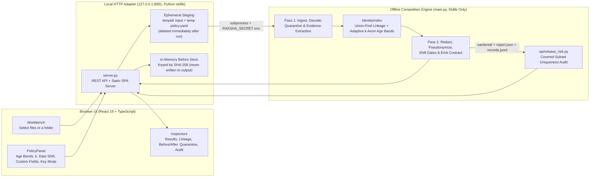
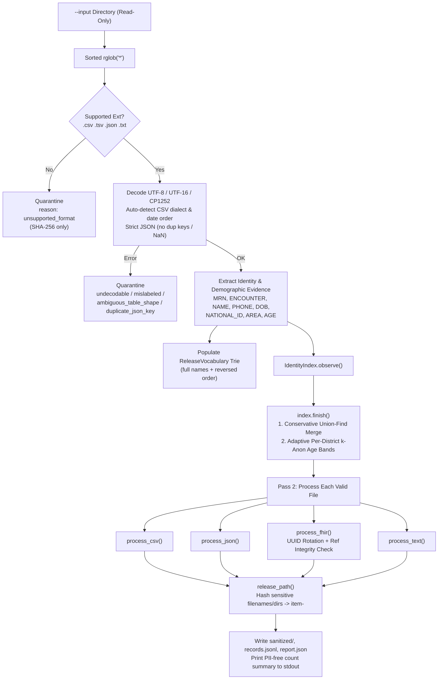

# Secret Wards — System Architecture & Technical Design

This document describes the architecture, algorithms, data flows, security boundaries, and API contracts of **Secret Wards (v4)** for **Yugaantar DevForge Track 3**.

---

## 1. High-Level System Architecture

Secret Wards strictly separates the **offline competition engine (`repository root`)** from the **interactive local web workbench (`demo-app/`)**. The competition runtime uses Python 3.10+ standard library only, requires zero network access, and never depends on the web server or browser.

### Architectural Invariants
- **Competition Boundary**: `raksha.toml` invokes `python main.py --input {input} --output {output}` directly. No frontend, database, LLM, or external API is part of the submitted engine.
- **Zero Secret Leakage**: `RAKSHA_SECRET` is passed exclusively via process environment variables. It is never printed to stdout/stderr, never written to `report.json`, `records.jsonl`, or `sanitized/`, and never returned in HTTP responses.
- **Fail-Safe Quarantine**: Any file that cannot be safely decoded, parsed, validated, or reference-checked is recorded by its input SHA-256 with `"status": "quarantined"` and `"output": null`. Raw uncleaned bytes are **never** copied into `sanitized/`.
- **Determinism**: Sorted directory traversal, deterministic union-find root selection, and HMAC-SHA256 derivation guarantee byte-identical outputs for identical inputs and secret.

---

## 2. Two-Pass Core Pipeline (`main.py`)

A single-pass pipeline cannot simultaneously discover all patient name aliases across files, link records across hospitals/scripts, and compute population-level k-anonymous age bands per district. Secret Wards executes in **two deterministic passes**:

---

## 3. Core Algorithms & Subsystems

### 3.1 Multilingual & Unseen-Schema PII Detection
Secret Wards layers **five independent detection mechanisms** so it generalizes to unseen datasets without memorizing training names:

1. **Normalized Schema & Role-Prefix Matching (`field_label`, `field_kind`)**:
   - Normalizes headers/keys with Unicode NFKC, casefolding, and separator stripping while preserving Devanagari combining marks (`matras`).
   - Strips vendor role prefixes (`patient`, `beneficiary`, `registrant`, `primary`, `home`, `emergency`, `subject`, `member`, `insured`, `client`, `ward`, etc.) so unseen columns like `Subject Legal Name`, `Home District`, `Patient Age (Yrs)`, `Emergency Callback`, or `Ward Registration Number` resolve automatically.
   - Honors user-configured `extra_redact_fields` (marked `[CUSTOM]`) and `extra_preserve_fields` (exempted from redaction).
2. **Script- & Digit-Aware Pattern Scanners (`PATTERNS`)**:
   - Matches **Devanagari (`०–९`) and ASCII (`0–9`) digits** across 14-digit **ABHA**, masked **Aadhaar** (`XXXX-XXXX-1234`), 12-digit **Aadhaar**, Indian mobile **PHONE** (`+91`/`+९१` optional), **EMAIL**, and **PAN**.
   - Avoids false positives on medical numbers (doses, vitals, `1-0-1`, ICD codes) using strict digit boundaries.
3. **Contextual Free-Text Rules (`CONTEXT_PATTERNS`)**:
   - 9 compiled rules capture unlabeled names in narrative clinical text: `called/witnessed/reported by`, timed visitor/attendant entries, `s/o` / `d/o` / `w/o` relative clauses, chat timestamps, Indian honorifics (`ji`, `sahab`, `didi`, `bhai`, `behenji`, `amma`, etc.), possessives (`X's attendant`), Hinglish vitals (`X ka BP/pulse/sugar`), and timed chief complaints (`10:30 - Name - c/o`).
   - Explicitly protects clinicians preceded by `Dr.`, `Doctor`, `Consultant`, `Physician`, or `डॉ.` (configurable via `preserve_doctors`).
4. **Release-Scoped Name Trie (`ReleaseVocabulary`)**:
   - Indexes multi-word patient names (and reversed word order) observed in explicit identity fields during Pass 1.
   - In Pass 2, scans free text, JSON values, and filenames in O(text length) using a prefix trie to catch bare name mentions that lack field labels.
5. **Hidden Channel Hygiene**:
   - Strips base64 attachment payloads (`data`, `content`, `payload`, `contentBase64`, etc.).
   - Hashes sensitive filenames, folder names, CSV headers, and private JSON map keys (`byName`, `byUhid`, etc.) to `item-<hmac24>`.
   - Applies optional user-defined literal terms (`extra_redact_terms`) and regex (`extra_redact_regex`).

### 3.2 Conservative Cross-Script Identity Resolution (`IdentityIndex`)
Linkage prioritizes **zero false merges** (precision weighted twice as heavily as recall in F0.5):

- **Evidence Pairs**: Generates corroborating linkage keys:
  - `("national", 12-or-14-digit Aadhaar/ABHA)`
  - `("phone-dob", last_10_digits, ISO_DOB)`
  - `("name-dob", raw_name, ISO_DOB)` & `("name-phone", raw_name, phone)`
  - `("cname-dob", canonical_phonetic_name, ISO_DOB)` & `("cname-phone", canonical_phonetic_name, phone)`
- **Devanagari → Latin Transliteration (`canonical_person_name`)**:
  - Converts Devanagari consonants, nuktas, matras, and vowels into an ASCII phonetic key, normalizes common honorific/abbreviation variants (`Md.`/`Mohd.`/`Mohammad` → `mohammad`), and collapses spelling doublets (`ee`→`i`, `oo`→`u`, `w`→`v`).
  - Enables cross-script linking (e.g., `"Mohd. Tariq Ansari"` + `"मोहम्मद तारिक़ अंसारी"` with matching DOB) even without a shared phone number.
- **Strict Conflict Guards**:
  - Two MRN clusters sharing a corroborating pair are merged **only** when their observed birth dates do not disagree and their national IDs of the same length do not disagree.
  - Records with ambiguous or conflicting candidate roots abstain (`"patient": null`) rather than risking a false merge.

### 3.3 Keyed Pseudonymization & Temporal Shifting
- **Pseudonyms (`PSN-<12 Crockford Base32 chars>`)**:
  $$\text{PSN} = \text{CrockfordBase32}_{12}\big(\text{HMAC-SHA256}(\text{RAKSHA\_SECRET},\; \text{canonical\_root\_key})\big)$$
  Non-reversible (A6 resistant), deterministic under the same secret, and changes when `RAKSHA_SECRET` rotates (A7 resistant).
- **Per-Patient Date Shifting**:
  $$\Delta_{\text{days}} = \big(\text{uint32}(\text{HMAC-SHA256}(\text{RAKSHA\_SECRET},\; \text{"shift|"} \| \text{key})) \bmod 2M\big) - M \quad (\text{if } 0 \Rightarrow +1)$$
  Every clinical date of a patient across CSV, JSON, FHIR, and text notes shifts by the exact same $\Delta_{\text{days}}$ (default $M = 180$). Lengths of stay (e.g., 9 days) and inter-visit intervals are preserved with 100% accuracy while real calendar dates are obscured.

### 3.4 Adaptive Per-District k-Anonymous Age Banding (`merge_age_intervals`)
Rigid age grids either over-coarsen dense cohorts or leave rare district/age tails unique. Secret Wards computes district-specific intervals:
1. Partition observed `(patient_root, age)` pairs in each district into base bins of width `age_band_years` (default `5`).
2. Merge adjacent bins that share the same longitudinal multi-visit patient (up to `age_band_max_years`, default `50`).
3. Greedily merge any bin with fewer than `age_k_anonymity` (default `2`) distinct patients with its narrowest valid neighbor (preferring merging two sparse bins or minimal span increase), stopping when all bins satisfy $k$ or further merging would exceed `age_band_max_years`.
4. Propagate each linked patient's resolved band consistently across CSV/TSV cells, JSON string and integer age fields, and labeled/inline free-text note ages (`Age/Sex:`, `आयु:`, `48 Y / F`). JSON age ranges are strings (for example, `25-29`) because an integer cannot represent an interval.

### 3.5 FHIR R4 Bundle Sanitization (`process_fhir`)
- Validates single-patient Bundle structure (`unsupported_fhir_patient_count` if $\neq 1$).
- Deterministically rotates every resource `id` and `fullUrl` to an HMAC-derived UUIDv4, updating all internal `reference` pointers and replacing Patient `display` names with `PSN-...`.
- Strips `Patient` PII (`name`, `birthDate`, `telecom`, `contact`, `text`, `extension`, `photo`, `link`, street address lines — keeping `district`/`state`/`country`) and `Encounter.identifier`, while inserting `urn:secret-wards:patient` with `PSN-...`.
- Runs a post-sanitization graph traversal asserting **every** internal reference resolves within the Bundle (`unresolved_fhir_reference` → Quarantine).

---

## 4. Web Workbench & REST API (`demo-app/`)

The local HTTP adapter (`server/server.py`) binds to loopback (default `127.0.0.1:8081`) and serves both the built React SPA (`dist/`) and the JSON API:

| Method | Endpoint | Purpose |
|---|---|---|
| `GET` | `/api/health` | Adapter readiness, available dataset presets, and default policy from `policy.yaml`. |
| `GET` | `/api/presets` | List bundled datasets with file counts, tags and the default seed for replayable scenarios. |
| `GET` | `/api/policy/defaults` | Default policy values and list of all 13 PII redaction categories. |
| `POST` | `/api/runs` | Launch an offline run (`source: "demo" \| "preset" \| "custom"`), with optional `files[]` (UTF-8 or base64), custom `policy` object, and `secret_mode` (`"default" \| "rotate" \| "custom"`). |
| `GET` | `/api/runs` | List recent runs in session history for comparison. |
| `GET` | `/api/runs/{id}` | Full run status, `counts`, `entities` breakdown, `timing`, `resources`, `records`, `risk`, and `policy_used`. |
| `GET` | `/api/runs/{id}/files` | File-by-file status (`sanitized`/`quarantined`), `reason`, and `has_before` flag. |
| `GET` | `/api/runs/{id}/file?path=...` | Sanitized file content (JSON wrapper by default; raw downloadable bytes when `&download=1`). Path traversal rejected (`403`). |
| `GET` | `/api/runs/{id}/before?sha256=...` | Ephemeral in-memory original text for side-by-side Before/After comparison (text files only; never raw quarantined binaries). |
| `GET` | `/api/runs/{id}/export` | Downloadable ZIP bundle containing `sanitized/`, `report.json`, and `records.jsonl` only. |
| `GET` | `/api/scorecard` | Official practice dataset verification summary. |

### Security Controls in the Local Adapter
- **No Raw Input Retention**: Uploaded/staged files live in an OS temp folder that is deleted in a `finally` block immediately after `main.py` exits.
- **Path Traversal Prevention**: Every uploaded relative path and every requested output file is resolved and asserted via `Path.relative_to(...)`.
- **Loopback-Only & Strict CORS**: Server binds exclusively to `127.0.0.1` with `X-Content-Type-Options: nosniff` and `Cache-Control: no-store` on API responses.
- **No Secret Exposure**: Even when the user selects `rotate` or enters a `custom` synthetic test key, only the mode label (`"default"`, `"rotate"`, `"custom"`) is stored in run metadata — never the secret bytes.

---

## 5. Hybrid Statistical ML Fallback Layer (v5: `ml_models.py` + `training/`)

To generalize beyond explicit field labels and fixed narrative templates without risking clinical false positives or exceeding Track 3's 2-CPU / 4 GiB / < 50M-parameter constraints, v5 layers **two offline-trained statistical models** behind strict deterministic guardrails:

1. **Multilingual Linear-Chain CRF (`models/ner_crf.json.gz`, 19.8 KB, 1,609 features):**
   - Trained offline via exact L2-regularized L-BFGS-B (`training/train_models.py`) on 4,000 disjoint synthetic English, Hindi (Devanagari), and Hinglish clinical sequences (plus clinical negative controls).
   - Uses strictly morphological, script, capitalization, and ±2-token discourse cue features (never raw proper nouns), making memorization impossible.
   - Executes exact **Viterbi decoding** and **Forward-Backward log-space marginal probabilities** in pure Python stdlib.
   - Runs line-by-line after deterministic redaction in `process_text()`, emitting `[NAME]` or `[ADDRESS]` only when mean token marginal probability `>= ml_ner_threshold` (default `0.85`), span is not a field label before `:`/`=`, is not preceded by a clinician cue (`Dr.`/`डॉ.`), and contains no protected clinical terms/eponyms/units.
2. **Header-Blind Column-Value Classifier (`models/col_clf.json.gz`, 30.3 KB, 2,113 features):**
   - Trained offline (`scikit-learn` Multinomial Logistic Regression, benchmarked alongside `LinearSVC`, `RandomForestClassifier`, and `MLPClassifier` saved in `training/artifacts/`).
   - Extracts 18 structural value ratios + L2-normalized character 2–3 grams purely from column values (blind to header names).
   - Runs in `table_evidence_labels()` on unrecognized CSV/TSV columns, inferring `NAME`, `ADDRESS`, `PHONE`, `EMAIL`, or `MRN` only when `P(pred) >= ml_col_threshold` (default `0.80`), `P(CLINICAL) < 0.05`, and never duplicating an existing `MRN` column or touching billing/order IDs or clinical catalog headers.

## Evidence from unfamiliar schemas

Numbered table fields such as `Field_427` can contribute email or phone evidence when a table already has patient context, at least two distinct nonempty values agree on the format, and there is a single candidate for that type. The release retains the supplied header. Unknown demographic names can use a custom policy rule.

The release index can attach a chartless record to an existing chart using a matching callback number and given name, or a full name, village and age within one year. These secondary clues never combine two chart roots. Multiple compatible roots or conflicting known birth dates and national identifiers cause abstention. JSON evidence follows patient and demographics objects. A decoded copy allows the redactor to recognize common text encodings while clean controls remain readable.

The local adapter exposes three reproducible generators alongside the three original fixed datasets. A preset request accepts an optional integer `seed` in the range 0 to 2147483647 for `ward_transfer`, `lab_exchange` and `rural_outreach`. Generation happens in a per-run temporary directory. Only the resulting source data is given to the offline engine. A seed is a replay parameter and is independent of the release key.
